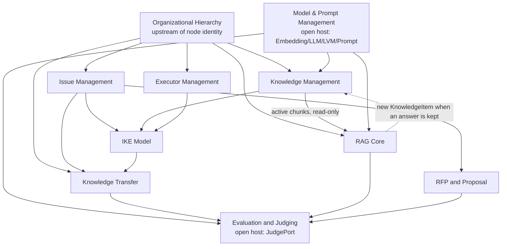

# Phase 3 — Context Map

Status: v1.0 (finalizes the Phase 1 draft). Date: 10 November 2026 (19 Aban 1405).
The ten context names and codes are unchanged. Three open points from the draft are decided below and flagged for supervisor confirmation.

## 1. Decisions on Phase 1 open points

| # | Open point | Decision in this phase | Why |
|---|---|---|---|
| 1 | Do `Executor` and `Node` share a kernel (a team node as an executor candidate)? | **No shared identity.** An `Executor` is a person (or named profile) with a `home_node`. A team node may be a referral *target*, never an `Executor`. The only shared type is `NodeIdentifier`. | Glossary term 63 allows “person, team, unit or capability”, but ArmanRayan evidence (AR-EXE-023) is personal profiles. Collapsing the two identities would mix leaf-node rules with referral capacity. Revisit only if the supervisor wants team-level assignment. |
| 2 | Does `ProjectRecord` need its own context? | **No.** It stays a supporting aggregate in Issue Management. | The corpus ties projects to issues (`PRJ-AZP-118` / AR-ISS-024). A eleventh context would add ceremony without a distinct lifecycle. Transfer and RFP *refer* to a `ProjectId`; they do not own the record. |
| 3 | FA/EN pairing: two KnowledgeItems or one? | **One `KnowledgeItem` per document id**, with a `KnowledgeVersion` per `(VersionTag, LanguageCode)`. | Assumption A7: both languages carry the same content and the same document id. Finding D4: the pair is linked, not deduplicated. `DuplicateDetector` returns `cross_language_pair`, never `exact`, for FA vs EN of the same id. |

Assumed answer to **Q3** (still formally open): a `knowledge_repository` node may have a parent that is not on `layer − 1`. ArmanRayan: `N-LIB` (L4) reports to `N-CEO` (L1). The invariant is implemented and tested. If the supervisor rejects Q3, the exemption is removed in one place (`Organization._assert_parent_child`).

## 2. Final context list

The responsibilities, aggregates and events of the Phase 1 table stand, with the decisions above applied. See `domain-model-spec.md` for the tactical model of each context.

## 3. Relationships

Legend: **U/D** upstream / downstream (downstream conforms to, or translates, the upstream model). **SK** shared kernel. **ACL** anticorruption layer (translate a foreign model at the boundary). **OH** open host service (a published port used by several customers). **C/S** customer / supplier.

| Downstream | Upstream | Pattern | What crosses the boundary |
|---|---|---|---|
| Almost every context | Hierarchy | SK + U/D | `NodeIdentifier`, `LayerIndex`. Downstream contexts never mutate the tree. |
| Knowledge, Issues, Executors, Transfer, RFP | Hierarchy | U/D | Owning / home / target node ids are validated against the tree by application services when those services exist. |
| RAG Core | Knowledge | U/D (read model) | Active chunks + metadata. RAG never edits a `KnowledgeItem`. A grounded answer that must become node knowledge is registered as a *new* item (spec 8.1 step 12). |
| RAG Core | Hierarchy | U/D | Node scope and the node-boundary filter. |
| RAG Core | Model & Prompt | OH | `EmbeddingPort`, `LlmPort`, `PromptRegistry`. |
| RAG Core, Transfer, RFP | Judging | OH | `JudgePort` + `JudgeRubric`. |
| Judging | Model & Prompt | U/D | Judge calls go through `LlmPort`; the judge rubric lives in Judging. |
| Knowledge | Model & Prompt | U/D | Embeddings for duplicate/overlap later; `LvmPort` during visual ingestion; `DocumentParserPort` is owned by Knowledge. |
| Issues | Knowledge | U/D + ACL | Issues store `DocumentId` / `KnowledgeItemId`, not Knowledge entities. |
| Executors | Hierarchy | SK | `NodeIdentifier` of the home team only. |
| IKE | Issues, Knowledge, Executors | U/D + ACL | IKE owns *relations* only. Endpoints are opaque string ids (`IssueId`, `DocumentId`, `ExecutorId`). No import of those aggregates. |
| Transfer | Issues, IKE, Hierarchy | U/D + ACL | Reads progress, key issues, relations and layer rules; assembles a `TransferPackage`. |
| Transfer | Judging | OH | Acceptance threshold (default 18/20). |
| RFP | Issues, Judging | U/D + OH | Related issue / project ids; judge for feedback later. |
| All generators (RAG, Transfer, RFP, Issues decomposition) | Shared kernel `FactValidator` | OH | Post-generation check of names, IDs and numbers (Phase 8). |

There is **no shared database** and no shared mutable entity across contexts. The shared kernel is a short list of immutable value objects (see `domain-model-spec.md` §0).

## 4. Context map (mermaid)

## 5. Use-case mapping (unchanged, with owners)

| Use case | Primary context | Supporting |
|---|---|---|
| UC-01 Register layers and 21 nodes | Hierarchy | — |
| UC-02 Ingest DOCX/DOC/PDF as a versioned KnowledgeItem | Knowledge | Models (LVM for layout) |
| UC-03 Detect duplicate / overlapping chunks | Knowledge | RAG (embeddings, later) |
| UC-04 Node-scoped question with citations or abstain | RAG | Knowledge, Hierarchy, Judging, FactValidator |
| UC-05 Create and decompose an issue | Issues | RAG, IKE, FactValidator |
| UC-06 Suggest executors | Executors | IKE |
| UC-07 Compute progress and priority | Issues | — |
| UC-08 Cyclic processing, store latest package | Transfer | Issues, IKE, Judging |
| UC-09 Deliver latest accepted package upward | Transfer | Hierarchy |
| UC-10 Generate RFP, evaluate proposals, feedback | RFP | Issues, Judging |
| UC-11 Score an output with the LLM judge | Judging | Models |
| UC-12 Detect research gaps, rank key issues | Issues | IKE, Judging |

## 6. Translation notes (ACL)

- **IKE** never holds a `SubIssue` or `Executor` object. A relation such as `AR-ISS-024/WIN --can_handle--> EX-ROOZBEH-MOHSENI` is three value-like strings plus a type and a confidence.
- **RAG** sees a chunk read model: `chunk_id`, text, heading path, document id, version, language, owning node, confidentiality, vector id. It does not load the `KnowledgeItem` aggregate to answer a question.
- **Transfer** copies facts into package fields and `Citation` values. After a package is accepted, the upper layer does not reach into the lower node's issue list.

## 7. Still open for the supervisor

- Confirmation of the three decisions in §1.
- Confirmation of the Q3 exemption already coded.
- Q1, Q2, Q4, Q5, Q6, Q7 from Phase 1 remain unanswered (Q8 is closed by the Phase 2 hardware baseline).
