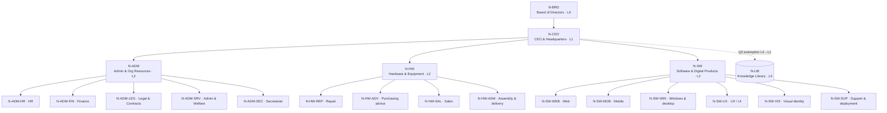

# Phase 6 — Nodes, layers and the organizational hierarchy

Kit version 0.6.0. Builds on Phase 3 (`hierarchy` bounded context) and Phase 5 (knowledge lifecycle).

## 1. Naming: "organization" in issue #6 = `hierarchy` context

Issue #6 talks about an *organization* context. The code already has the
Phase 3 **`rag_core.hierarchy`** bounded context whose aggregate root is
**`Organization`**. Phase 6 extends it; no second `organization` package exists.

| Issue #6 term | Code |
|---|---|
| organization / org chart | `hierarchy.domain.model.Organization` (aggregate root) |
| layer registry | `Organization.layers` (`Layer` value objects) + `data/registry/layer-registry.csv` |
| node | `hierarchy.domain.model.Node` (entity, `NodeStatus` active/retired) |
| transfer requirement | `hierarchy.domain.transfer.TransferRequirement` (on `Layer.transfer`) |
| document ↔ node mapping | `hierarchy.domain.ownership.DocumentOwnership` + `data/registry/document-node-map.csv` |
| scope resolution | `hierarchy.domain.scope.ScopeResolver` / `RetrievalScope` |
| leaf boundary / escalation | `hierarchy.domain.scope.leaf_boundary`, `route_question` |
| registry validator | `hierarchy.domain.validation.RegistryValidator` |
| CSV loader | `hierarchy.infrastructure.registry_csv.CsvRegistryLoader` |
| use cases | `hierarchy.application.workflows` (`load_and_validate`, `HierarchyWorkflowService`, `coverage`, `scope_sizes`) |

## 2. The ArmanRayan tree (21 nodes, L0–L4)



Nodes per layer: L0 = 1, L1 = 1, L2 = 3, L3 = 15, L4 = 1. Leaves: 16 (the 15
L3 units/teams and N-LIB). Max depth: 3 (depth ≠ layer: N-LIB is depth 2, layer 4).

## 3. Registry files (`data/registry/`)

* `layer-registry.csv` — Phase 1 columns + transfer columns
  (`transfer_direction, transfer_target, must_hand_over, min_artefacts, approvals_required, required_feedback, transfer_sources`; lists use `;`).
* `node-registry.csv` — Phase 1 columns + `status` (`active`/`retired`) and
  `escalation_node_id` (blank = parent).
* `document-node-map.csv` — `document_id, node_id, role, source`; roles:
  `owner` (exactly one per document = catalog owning node), `co_owner`
  (catalog additional nodes), `described_in` (the document describes/governs the node).

## 4. Validation rules

R1–R5 come from the Phase 1 registry README; the rest are new.

| Code | Rule |
|---|---|
| N-ID / N-DUP / N-ROOT | id format `N-XXX[-YYY]`, unique ids, exactly one root (R1) |
| N-PARENT / N-CYCLE | parent exists, no cycles (R2) |
| N-ADJ | child layer = parent layer + 1, **except** the explicit Q3 exemption `(knowledge_repository, L4 → L1)` (R3) |
| N-LEAF | a leaf has no children; parent may not be a leaf (R4). Non-leaf without children → warning |
| N-TECHNAME | technology names (React, Flutter, …) are capabilities, never node names (R5) |
| N-TYPE / N-TYPE-LAYER / N-LAYER | node type valid and on its layer (board L0, parent org L1, deputy L2, unit/team L3, repository L4) |
| N-DETAIL | `transfer_detail_level_to_parent` = the parent layer's `default_detail_level_received` (Q3 node exempt) |
| N-ESCALATION | escalation node exists and is an ancestor |
| N-SOURCE | source documents exist in the catalog |
| N-STATUS / N-CONF / N-RETIRED-PARENT | valid status and confidentiality (`per item` accepted), no active node under a retired one |
| N-COSTCENTER | warning only (N-LIB has no cost center in the Phase 1 data) |
| L-* | layer indices unique and contiguous from 0, `L{n}` codes, bilingual names, detail level ∈ {executive, managerial, technical_summary, detailed_technical}, judge score 0–20, integer word limit |
| T-* | every layer has a transfer requirement: valid direction, target layer exists (up → n−1, down → n+1), hand-over text, ≥ 2 minimum artefacts, ≥ 1 approval, required feedback, source documents |
| M-* | document map: ids in the catalog, node exists, role valid, no duplicate link, exactly one owner per document, owner = catalog owner, retired nodes own nothing; unmapped corpus documents → warning |

The validator works on raw rows and reports **all** issues; only a clean
registry is turned into the aggregate (which re-checks invariants on its own).

## 5. Leaf-node boundary and escalation

A leaf (L3 unit/team or the library) **owns** the documents mapped to it as
`owner` and co-owns those mapped as `co_owner`; it answers questions whose
evidence lies inside its retrieval scope (section 7). `leaf_boundary(node)` returns
owned / co-owned documents, activity domain and escalation target.

`route_question(asking, evidence_owners, reserved_decision)` (AR-ORG-002 §7, AR-BRD-003):

| Situation | Result |
|---|---|
| all evidence in scope (own, ancestors, library) | **answer** at the asking node |
| evidence held by a sibling team | escalate to the common deputy (e.g. WEB + MOB → N-SW) |
| evidence across deputies | escalate to N-CEO (e.g. WEB + HW-REP) |
| reserved decision (budget, contracts > 2,000M toman, raises > 25 %) | escalate to N-BRD |

## 6. Per-layer knowledge-transfer requirements

| Layer | Direction | Hands over | Minimum artefacts | Approvals | Feedback |
|---|---|---|---|---|---|
| L0 Board | down → L1 | resolutions and reserved-approval outcomes with conditions | approved minutes (quorum, dissent); resolution text with conditions and responsible executive; follow-up register entry | majority of eligible members present; quorum = majority of full Board | CEO reports progress at the next meeting |
| L1 CEO | up → L0 | risk, commitment ceiling, requested decision; consolidated performance, receivables, budget | TransferPackage CSV; one-page executive summary; quarterly financial report (AR-FIN-008); decision request with technical & legal support | CEO sign-off; finance-member review | approval or request for evidence recorded |
| L2 Deputies | up → L1 | joint plan, cost/time impact, dependencies, risks, capacity | TransferPackage CSV; managerial recap; joint delivery/recovery plan; cost & time impact | VP sign-off | CEO resolves competing priorities |
| L3 Teams/units | up → L2 | dependencies, risk, capacity; full issue detail with test evidence and executor mapping | TransferPackage CSV; technical summary; test evidence; handover package (glossary, error contract, rollback) | team-lead review; receiving deputy acknowledgement | VP returns priorities and technical decisions |
| L4 Library | peer ↔ L3 | indexed, citable records linked to issues (no upward summaries) | indexed KnowledgeItem with version and owner; link to the issue; earlier versions preserved | owner validation before publishing a lesson; access control for restricted items | library indexes and links records |

Sources: AR-TRN-026 §6, AR-ORG-002, AR-BRD-003, AR-FIN-008, AR-SW-022.
`TransferRequirement.gaps()` reports incomplete requirements and
`check_package(artefacts, approvals)` what a concrete hand-over is still missing.
Coverage in the shipped registry: **5/5 layers complete**.

## 7. Retrieval scope (which knowledge a query at node X may see)

| Rule | |
|---|---|
| S1 | X and all its active descendants (chain of command reads down) |
| S2 | ancestors' non-restricted items (policy flows down) |
| S3 | the L4 library serves every L0–L3 node (items keep their own confidentiality) |
| S4 | siblings / cousins are invisible unless X is a co-owner |
| S5 | restricted items: owner, co-owners, `described_in` readers (e.g. N-CEO for AR-BRD-003) and the chain of command of the owner or co-owners |
| S6 | a retired node cannot be a query scope |
| — | public items are always visible |

Visible documents per node in the shipped data: N-BRD 26, N-CEO 26, N-SW 12,
N-SW-WEB 6, N-ADM-HR 9, N-LIB 4. `RetrievalQuery.node_scope` (rag context)
is the node passed to `ScopeResolver.resolve`; wiring it into retrieval comes later.

## 8. Workflows

* **add node** — `Organization.add_node`: parent must exist and be active,
  layer/type rules apply, emits `NodeRegistered`.
* **move node** — `Organization.move_node(node, new_parent)`: root cannot move;
  new parent active, not a leaf, not inside the node's subtree (no cycles);
  layer adjacency / Q3 rule re-checked; the subtree moves along; emits `NodeMoved`.
* **retire node** — `HierarchyWorkflowService.retire_node(node, successor=None)`:
  root cannot retire; active children must be moved or retired first; successor
  defaults to the escalation node (= parent); it must be active and not the
  node itself; library knowledge goes only to another repository or to N-CEO.
  The node becomes `retired` (kept for history, `successor_id` set), emits
  `NodeRetired`; `DocumentOwnership.reassign` moves `owner`/`co_owner` links to
  the successor (redundant co-ownerships dropped, `described_in` kept) and emits
  `KnowledgeReassigned`.
* **queries** — `path`, `path_string`, `ancestors`, `descendants`, `depth`,
  `max_depth`, `leaves`, `nodes_on_layer`, `is_ancestor`, `lowest_common_ancestor`.

## 9. Coverage report (shipped data)

* Documents mapped 26/26, unmapped 0. Links: 26 owner, 27 co_owner, 15 described_in.
* Nodes owning documents: 17 of 21.
* Leaves without owned documents: **N-ADM-SRV, N-ADM-SEC** (only `described_in` links
  to AR-ORG-002 / AR-HR-011).

## 10. Running

```bash
python scripts/run_hierarchy_check.py      # or bash scripts/setup_and_test.sh
```

Prints the `PHASE 6 SUMMARY` block and writes `results/phase-06/hierarchy-<UTC>.json`
(the workflow simulation runs on an in-memory copy; CSVs are never modified).

## 11. Open questions

1. Should ancestors see **restricted** documents of subordinates (current rule: yes, chain of command), e.g. N-SW reading AR-EXE-023?
2. On retirement, should knowledge go to the parent by default (current) or to a named sibling?
3. Do N-ADM-SRV and N-ADM-SEC need their own corpus documents?
4. Confirm Q3: the library stays an L4 repository under N-CEO and is the only layer-skip exemption.
5. Is the Board's downward hand-over (resolutions) a "transfer" in the TransferPackage sense, or only feedback?
