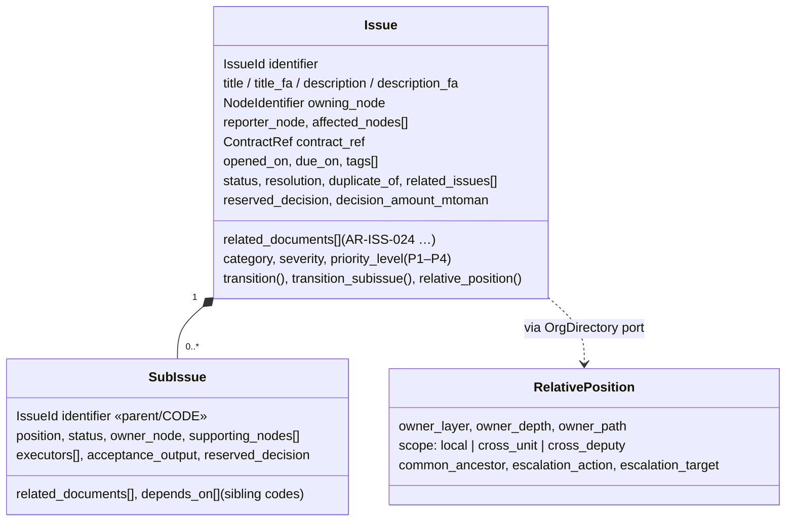
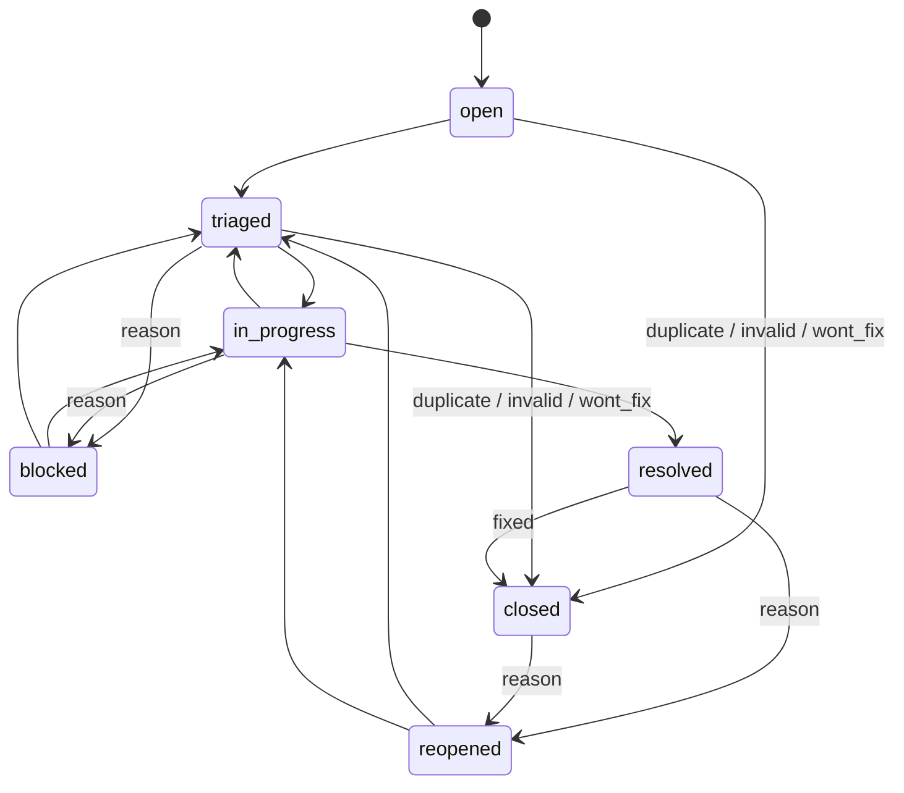

# Phase 7 — Issue and sub-issue model

Kit version 0.7.0. The reference case is **Azarpakhsh** (AR-ISS-024). Phase 7 builds on the Phase 3 `issues` bounded context, Phase 5 text fingerprints and the Phase 6 hierarchy registry.

## 1. Where things live

Issue #7 lists `src/issues/…`. Following the earlier phases, the code is in the existing `rag_core.issues` bounded context:

| Issue #7 output | Code |
|---|---|
| Issue, SubIssue | `issues/domain/model.py` (`Issue` aggregate root, `SubIssue` entity, `RelativePosition`) |
| status | `issues/domain/status.py` (`IssueStatus`, `StatusCategory`, `Resolution`, `TRANSITIONS`) |
| comparison.py | `issues/comparison.py` (public entry), implemented in `issues/domain/comparison.py` |
| sub-issue generation | `issues/domain/decomposition.py` (`RuleBasedDecomposer`, `ARMANRAYAN_RULES`) |
| ports | `issues/domain/ports.py` (`OrgDirectory`, `TextEmbedder`, `IssueDecomposer`) |
| hierarchy ACL | `issues/infrastructure/hierarchy_acl.py` (`HierarchyOrgDirectory`) |
| registry | `issues/domain/validation.py`, `issues/infrastructure/registry_json.py`, `data/issues/` |
| use cases | `issues/application/services.py` (`IssueService`, `load_issue_registry`) |
| tests | `tests/unit/issues/` |

The issues context **never imports the hierarchy aggregate**. Its domain asks the `OrgDirectory` port for node facts: does the node exist, its layer, depth and path, the lowest common ancestor, and an escalation route. The only adapter is `HierarchyOrgDirectory`, which translates the Phase 6 `Organization` and reuses Phase 6 `route_question`.

## 2. Model



* **Parent link**: a sub-issue id is `<parent>/<CODE>` (e.g. `AR-ISS-024/WIN`). The id can hold only one level, so sub-issues of sub-issues cannot exist and parent cycles are impossible.
* **Metadata** is validated in the aggregate:
  * contract refs look like `AR-CNT-1402-118`;
  * the due date is not before the opening date;
  * an issue cannot link to itself;
  * tags are normalized.
* `Issue.create(..., directory=org)` rejects nodes that are not active in the Phase 6 registry.
* **Approval authority** (AR-LEG-009): ≤ 500M toman → unit; > 500M → CEO; > 2,000M → Board. An issue or sub-issue is a *reserved decision* when it is flagged as one, or when its amount reaches the Board level.

## 3. States and transitions



| Category | States |
|---|---|
| todo | open, triaged, reopened |
| active | in_progress |
| waiting | blocked |
| done | resolved, closed |

Phase 3 status names are kept as aliases: new→open; analysing, knowledge_identified and executor_identified→triaged; solution_proposed→in_progress; awaiting_decision and unresolved→blocked; archived→closed.

### Aggregate invariants

1. **A parent cannot resolve or close as fixed while any sub-issue is open.** AR-ISS-024 §7: "Resolving one sub-issue does not close the parent issue."
2. **A sub-issue cannot change while its parent is closed.**
   * When a parent is closed as *invalid*, *duplicate* or *wont_fix*, it closes its open sub-issues with the same resolution.
   * After that the sub-issues are frozen.
   * New sub-issues cannot be added to a closed parent.
3. **A sub-issue cannot resolve while a dependency it waits on is open.** In Azarpakhsh, WIN and LEG wait for HW.
4. **Sub-issue dependencies form a DAG.** A cycle is rejected and the change is rolled back. `duplicate_of` chains in the registry are also checked for cycles.
5. **Reopening a sub-issue reopens a resolved parent.** AR-ISS-024 §7: "Failed tests return to the relevant sub-issue without deleting failure history." Every transition is appended to `history` and raises a domain event.
6. **All nodes must exist in the Phase 6 registry**: owner, reporter, affected, sub-issue owners and supporting nodes.

## 4. Relative position

`Issue.relative_position(directory)` and `Issue.subissue_position(code, directory)` return:

* the owner node's **layer**, **depth** and **path**;
* **scope**:
  * `local`: every involved node is inside the owner's subtree;
  * `cross_unit`: the common ancestor is an L2 deputy (or deeper);
  * `cross_deputy`: the common ancestor is L1 or L0;
* the **escalation target** from Phase 6 `route_question`:
  * the issue is answered by its owner when all involved nodes are in scope;
  * otherwise it escalates to the lowest common ancestor;
  * reserved decisions go to N-BRD.

Azarpakhsh:

| Item | Owner | Layer / depth | Scope | Escalation |
|---|---|---|---|---|
| AR-ISS-024 | N-LIB | L4 / 2 | cross_deputy | N-CEO |
| /HW | N-HW-REP (+ADV, ASM) | L3 / 3 | cross_unit | N-HW |
| /WIN | N-SW-WIN | L3 / 3 | local | N-SW-WIN (answers) |
| /WEB | N-SW-WEB (+UX) | L3 / 3 | cross_unit | N-SW |
| /LEG | N-ADM-LEG (+FIN) | L3 / 3 | cross_unit | **N-BRD** (reserved: the 2,180M contract is above the Board threshold; AR-FIN-008 decision 2) |

## 5. Comparison algorithm (`comparison.py`)

The comparison is deterministic, offline and uses only the standard library. No model is called.

1. **Tokens.**
   * Phase 5 `fingerprint.tokens`: NFKC, Arabic ي/ك → Persian, Persian digits → Latin, ZWNJ joined, punctuation removed, lower case.
   * Then FA/EN stop-words and numbers are dropped, and Persian `ها/های` and English plural `s` are stripped.
2. **Text similarity.**
   * For each language text of the candidate (EN, FA): `0.5·Jaccard + 0.5·containment(new ⊆ old)`.
   * The best language is kept, so a Persian report is matched against the Persian text and is not diluted by the English half.
3. **Metadata similarity.** A field that is empty on both sides is skipped and the remaining weights are renormalized.

   | Field | Measure | Weight |
   |---|---|---|
   | nodes (owner + affected) | overlap coefficient | 0.35 |
   | documents | overlap coefficient | 0.30 |
   | category | equal | 0.15 |
   | contract | equal | 0.20 |

4. **Score.** `0.6·text + 0.4·meta`. With the optional `TextEmbedder` port the score is `0.45·text + 0.20·cosine + 0.35·meta`. No embedder is wired in, and tests use a fake one.
5. **Labels.**

   | Label | Rule |
   |---|---|
   | duplicate | score ≥ **0.60** and text ≥ **0.45** (metadata alone can never make a duplicate) |
   | related | score ≥ **0.25** |
   | new | otherwise |

6. **Candidates and ranking.**
   * Candidates are issues *and* sub-issues. A sub-issue inherits the parent's contract and customer.
   * An issue closed as a duplicate is folded into its canonical issue, which keeps the better score (`via`).
   * Ranking: score descending, then issues before sub-issues, then id.
   * For registries with ≥ 200 candidates a MinHash prefilter (Phase 5 `MinHasher`) drops candidates that share neither text, nodes nor documents. Exact scores are unchanged.

Results on the samples (`data/issues/new-issue-samples.json`), from the reference run in §8:

| Sample | Language | Label | Best match | Score (text / meta) |
|---|---|---|---|---|
| AR-ISS-041 RAID/RAM + Windows client delay | fa | duplicate | AR-ISS-024 | 0.732 (0.632 / 0.883) |
| AR-ISS-042 Windows driver after RAM change | en | related | AR-ISS-024/WIN | 0.642 (0.404 / 1.000) |
| AR-ISS-043 DashtPakhsh Flutter schedule slip | en | duplicate | AR-ISS-031 | 0.734 (0.556 / 1.000) |
| AR-ISS-044 new exhibition logo | fa | new | — | 0.036 |

The thresholds were calibrated on this small seed set. Revisit them when real issues arrive.

## 6. Decomposition rules

`RuleBasedDecomposer` matches cause-path rules against the normalized title and description (both languages).

* A phrase matches when all of its tokens occur.
* The rules come from AR-ORG-002 §4–6, AR-EXE-023 and AR-ISS-024 §3:

| Code | Owner | Supporting | Example triggers | Depends on | Reserved |
|---|---|---|---|---|---|
| HW | N-HW-REP | N-HW-ADV, N-HW-ASM | raid, controller, ram, memory, firmware, کنترلر, حافظه | — | no |
| WIN | N-SW-WIN | — | windows, driver, desktop, ویندوزی, درایور, کلاینت | HW | no |
| WEB | N-SW-WEB | N-SW-UX | web reporting, dashboard, گزارش‌گیری وب | — | no |
| LEG | N-ADM-LEG | N-ADM-FIN | contract, penalty, amendment, delivery delay, قرارداد, جریمه | HW | yes |
| FIN | N-ADM-FIN | — | receivable, invoice, billing, مطالبات | — | no |
| MOB | N-SW-MOB | — | mobile, flutter | — | no |
| SUP | N-SW-SUP | — | outage, incident, sla | — | no |
| UX | N-SW-UX | — | wireframe, usability, تجربه کاربری | — | no |

* **No generic hardware trigger.** The word *server* alone does not trigger HW, because AR-ISS-024 warns against collapsing the paths into a vague "server problem".
* **Dependencies on absent paths are dropped.** A dependency is kept only when the path it points to also fired.
* **Per-affected-unit fallback.** Any affected node not covered by a fired rule gets one generic sub-issue (code `U<NODE>`).
* **Owners must exist.** Owners and supporting nodes are checked through the `OrgDirectory` port.
* **Idempotent apply.** `apply()` skips existing codes and numbers the new positions after the existing ones.
* **Optional LLM port.** An LLM decomposer can implement the same `IssueDecomposer` port. `IssueService` accepts any decomposer. No LLM adapter exists in Phase 7.

**Azarpakhsh worked example.** The issue text names the RAID controller and RAM, the Windows client and drivers, web reporting delay, and the contract / delivery date / penalty. Decomposition produces HW → N-HW-REP, WIN → N-SW-WIN (after HW), WEB → N-SW-WEB and LEG → N-ADM-LEG (after HW, reserved). This is the same set as the seeded registry and the AR-ISS-024 table. The table lists HW, WIN and LEG; WEB comes from §1 and §5 of the document. Closure needs all three evidence groups (§7): tested hardware with joint Windows results, accepted software scope including web reporting, and a written disposition of the delivery date and contractual responsibility.

## 7. Seed registry (`data/issues/`)

* `issue-registry.json` holds AR-ISS-024 from the corpus and six synthetic issues derived from corpus facts:
  * 031: DashtPakhsh mobile schedule;
  * 032: Azarpakhsh 185M receivable;
  * 033: Rahavard Sanat portal handover;
  * 034: Rahavard Sanat workstation startup faults, closed;
  * 035: Azarpakhsh reporting contractor RFP;
  * 036: the hypothetical "slow outbound recording" scenario from AR-ISS-024 §9, closed as a duplicate of 024.
* `new-issue-samples.json` holds four incoming issues with expected labels.
* The validator checks:
  * ids;
  * nodes against the Phase 6 registry and documents against the catalog;
  * contract, enum values, status, dates and resolution;
  * duplicate and related links, and cycles;
  * sub-issue parent links, positions, dependencies and cycles;
  * open sub-issues under a done parent.
* It reports all errors at once. Only a clean registry is built into aggregates.

## 8. Running

```bash
python scripts/run_issue_check.py     # or bash scripts/setup_and_test.sh
```

`setup_and_test.sh` runs the scripts in order: pytest, ingest, dedup, hierarchy, then the issue check. The last block, `PHASE 7 SUMMARY`, carries:

* the pytest counts;
* the exit codes of the earlier steps;
* the issue-check stats;
* the overall PASS/FAIL.

It also writes `results/phase-07/issue-check-<UTC>.json`.

### Reference run

* Test system: Ubuntu 24.04.5 LTS, Python 3.12.3, Intel Core i5-12400F, 16 GB RAM, NVIDIA RTX 3060 12 GB (GPU not used by the tests); project at `~/Desktop/RAG`.
* Run: 2026-11-18 20:47:50 UTC (2026-11-19 00:17 Tehran time).
* Result: `status: PASS`, 474 passed, 0 failed, 0 skipped; earlier steps ingest, dedup and hierarchy all exited 0; 7 issues and 4 sub-issues, 0 validation errors or warnings; all six checks ok.
* Results file: `results/phase-07/issue-check-20261118T204750Z.json`.

## 9. Open questions

1. **Seed ids.** The synthetic seed issues use `AR-ISS-031…036`, which share the corpus document-id namespace (AR-ISS-024 is both a document and an issue). Should issues get their own prefix?
2. **Owner of AR-ISS-024.** The issue owner is N-LIB, as in the catalog. Should the *operational* owner be N-CEO instead, since the CEO coordinates the recovery plan?
3. **LEG escalation.** Is LEG escalating to the Board right? The contract is above 2,000M, but the hardware amendment (95M) alone is unit-level.
4. **Thresholds.** The comparison thresholds were tuned on seven issues and four samples. They need recalibration on real data.
5. **"Cannot close while parent is invalid".** This was implemented as follows: sub-issues of a closed or invalid parent are frozen, and an invalid parent closes them. Is that the intended meaning?
