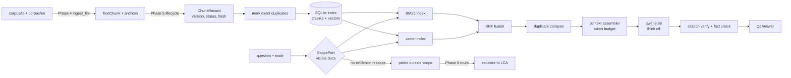

# Phase 8 — RAG retrieval core and node-scoped Q&A

Kit version 0.8.0. Phase 8 turns the Phase 4 chunks, the Phase 5 lifecycle and duplicate data and the Phase 6 hierarchy into a working offline retrieval + question-answering pipeline. Everything runs on the local machine: embeddings and generation go to the local Ollama server (`http://localhost:11434`) through the standard library (`urllib`). Unit tests use fakes and never need Ollama, the GPU or the internet.

## 1. Where things live

| Issue #8 output | Code |
|---|---|
| embedding adapter | `rag/infrastructure/ollama.py` (`OllamaClient`, `OllamaEmbedder`, `OllamaChatModel`) |
| index | `rag/domain/lexical.py` (BM25), `rag/domain/vector.py` (cosine), `rag/infrastructure/sqlite_store.py` (persistent index) |
| index build | `rag/application/indexing.py` (`records_from_lifecycle`, `mark_exact_duplicates`, `IndexBuilder`, `build_retriever`), `rag/application/corpus.py` |
| retriever | `rag/domain/retriever.py` (`HybridRetriever`), `rag/domain/fusion.py` (RRF) |
| context assembler | `rag/domain/context.py` (`ContextAssembler`) |
| scope port | `rag/domain/ports.py` (`ScopePort`), ACL `rag/infrastructure/scope_acl.py` (`HierarchyScope`) |
| records and filters | `rag/domain/records.py` (`ChunkRecord`, `SourceRef`, `SearchFilters`) |
| Q&A | `qa/application/service.py` (`NodeScopedQaService`), `qa/domain/model.py` (`QaAnswer`, `QaStatus`) |
| citations | `qa/domain/citations.py` |
| fact check | `qa/domain/fact_check.py` (`CitedFactValidator`, implements the Phase 3 `FactValidator` port) |
| prompts | `config/prompts/qa/answer.yaml`, `config/prompts/qa/messages.yaml`, loader `qa/infrastructure/prompt_yaml.py` |
| settings | `config/rag.yaml`, loader `rag/infrastructure/config.py` |
| evaluation | `qa/application/evaluation.py`, questions `data/rag/sample-questions.json` |
| demo | `scripts/run_rag_demo.py` |
| tests | `tests/unit/rag/`, `tests/unit/qa/`, fakes in `tests/fixtures/rag/fakes.py` |

The `rag` context depends on the other contexts only through ports: the hierarchy is reached through `ScopePort` and the ACL `HierarchyScope`; embeddings through the Phase 3 `EmbeddingPort`; generation through `ChatModelPort`.

## 2. Pipeline

### 2.1 Records

One `ChunkRecord` per chunk per document version. The key is `DOC@version/lang#cNNNN`, e.g. `AR-HR-005@1.0/fa#c0012`. Every record carries:

- `document_id`, `language`, `version`, `order` (chunk number);
- owner node and its layer (from the Phase 6 registry), knowledge class and confidentiality (from the catalog);
- lifecycle status and version status (Phase 5), so superseded versions stay in the store but are never searched;
- `content_hash` (Phase 5 `normalized_hash`) and `duplicate_of`;
- the source anchor: page (PDF), paragraph index (DOCX) or table, and the heading path.

Only `corpus/fa` and `corpus/en` are indexed. Derived renditions (PDF/DOC/TXT copies of the same document) would only add exact duplicates.

### 2.2 Persistent index

`SqliteIndexStore` keeps three tables: `meta`, `chunks` (the records as JSON) and `vectors` (float32 blob, embedding model, content hash). `IndexBuilder.refresh()` is incremental:

- a vector is reused when `(key, content_hash, model)` matches;
- new or changed active chunks are embedded in batches (`embedding.batch_size`, 16 by default);
- vectors of removed or retired chunks are deleted;
- changing the embedding model drops all vectors of the old model.

The file lives at `.rag-index/phase-08.sqlite` (git-ignored). `--rebuild` deletes it. Vector search is a pure-Python cosine scan over L2-normalised `array('f')` vectors. With about 1,200 chunks × 1,024 dims this takes a few tens of milliseconds, so no numpy or FAISS dependency is needed.

### 2.3 Scope and filters

Retrieval always starts from the asking node:

1. `ScopePort.visible_documents(node)` returns the documents the node may read. This reuses Phase 6 `ScopeResolver` (own subtree + inherited policy, confidentiality rules).
2. `SearchFilters` narrow the candidates further: `languages`, `document_ids`, `layers`, `knowledge_classes`, `active_only` (default true).
3. Both BM25 and vector search receive the allowed key set, so out-of-scope text never reaches the ranking.

### 2.4 Hybrid ranking and fusion

- **BM25** (`k1=1.2`, `b=0.75`) on Persian/English tokens. Persian text is normalised first (ي/ك → ی/ک, ZWNJ removed, Persian digits → Latin), stopwords are dropped and a light plural stem is applied (`ها`, `های`, `s`).
- **Vector**: cosine between the bge-m3 query embedding and the chunk embeddings. bge-m3 is multilingual, so a Persian question also finds the English copy.
- **Reciprocal Rank Fusion**: `score(d) = Σ w_i / (k + rank_i(d))`, `k = 60`, both weights 1. RRF only needs ranks, so the BM25 and cosine scales do not have to be calibrated.

`candidate_k` (30) candidates are taken from each list; after fusion and duplicate collapse the top `top_k` (5) hits are kept. Without an embedder the retriever runs in lexical-only mode; this is used by the offline dry run.

### 2.5 Duplicate collapse

Template clauses repeat across ArmanRayan documents. After fusion a hit is dropped when, in the same language, it is:

- marked as an exact duplicate (`duplicate_of`) of a better-ranked hit or has the same `content_hash`, or
- a near duplicate: Phase 5 shingle Jaccard ≥ `near_duplicate_threshold` (0.80, the Phase 5 `DedupConfig` value).

The Persian and English copies of the same chunk are not collapsed: they support answers in both languages.

### 2.6 Context assembler

`ContextAssembler(budget_tokens=3500, max_block_tokens=900)`:

- takes hits in rank order while the token estimate (Phase 4 `estimate_tokens`) fits the budget;
- truncates a long block at a word boundary and adds ` […]`;
- orders the selected blocks by the best rank of their document, then by chunk order, so text from one document reads in sequence;
- puts a header on every block: `[AR-HR-005 §12] AR-HR-005 v1.0 (fa) · §12 · ¶41 · ۵. مرخصی ساعتی` (page `p.N` for PDF, `table N` for tables). When the Persian and English copies of one section are both present the labels get `/fa` and `/en`.

3,500 tokens of context plus the prompt and a 1,024-token answer fit in `num_ctx = 8192`, which qwen3:8b runs comfortably on a 12 GB GPU.

## 3. Q&A

### 3.1 Prompt

`config/prompts/qa/answer.yaml` (`qa.answer@2.0.0`, based on the Phase 2 `qa.grounded@1.0.0`) is rendered with the Phase 3 `PromptAssembler`. The system prompt requires the model to:

- use only the CONTEXT;
- cite every statement with the block label, e.g. `[AR-HR-005 §12]`;
- copy numbers and identifiers exactly;
- answer in the language of the question (`answer_language` = Persian or English, detected from the question);
- reply `INSUFFICIENT_CONTEXT` when the context does not contain the answer;
- keep the answer to at most four sentences.

Generation settings come from `config/rag.yaml`: `qwen3:8b`, `think: false`, temperature 0.2, top_p 0.9, seed 42. Any `<think>…</think>` text is stripped. If the Ollama version rejects the `think` field the client retries once with the `/no_think` soft switch.

### 3.2 Decision flow

| Situation | Status | Model called? |
|---|---|---|
| No in-scope evidence (best cosine < `evidence_min_vector` 0.45; BM25 < 3.0 in lexical mode), strong evidence outside the scope | `out_of_scope` + escalation | no |
| No evidence anywhere | `not_found_in_scope` | no |
| Model replies `INSUFFICIENT_CONTEXT`, outside evidence stronger by `escalate_margin` | `out_of_scope` + escalation | yes |
| Model replies `INSUFFICIENT_CONTEXT` | `insufficient_context` | yes |
| Otherwise | `answered` (+ citation and fact check) | yes |

Escalation uses Phase 6 `route_question`: the target is the lowest common ancestor of the asking node and the owners of the outside documents. Only the target node and the owners are returned, never the outside text. Example: N-SW-WEB asks about unpaid leave → the answer lives in AR-HR-005 (owner N-ADM-HR) → escalate to N-CEO.

Refusal messages come from `config/prompts/qa/messages.yaml` in Persian and English.

### 3.3 Citations

`parse_citations` accepts `[AR-HR-005 §12]`, `[AR-HR-005 §12/en]`, `[AR-HR-005#c0012]`, document-level `[AR-HR-005]`, several references in one bracket (`;` `,` `،` `؛`) and Persian digits. Each citation is verified against the assembled context:

- chunk citation: valid when that block was in the context;
- document citation: valid when any block of that document was in the context;
- otherwise invalid with the reason `document not in retrieved context` or `section not in retrieved context`.

An answer is **grounded** when it has at least one citation and no invalid one. `QaAnswer.to_rag_answer()` bridges to the Phase 3 `Answer`: grounded answers keep their `Citation` objects; everything else becomes `ABSTAINED`.

### 3.4 Basic fact check

`CitedFactValidator` extracts identifiers (document, contract, issue, sub-issue, node, project IDs) and numbers (Persian/Latin digits, thousands separators, decimals, percent) from the answer text without the citation brackets. Each claim is checked:

- `CONFIRMED`: found in a cited chunk (number words such as "four" / «چهار» count; a cited document confirms its own ID);
- `FLAGGED`: found only in an uncited context block;
- `UNSUPPORTED`: found nowhere in the context.

Flags are reported, not used to rewrite the answer.

## 4. Configuration (`config/rag.yaml`)

| Key | Value | Why |
|---|---|---|
| `ollama.base_url` | `http://localhost:11434` | only local hosts are accepted |
| `ollama.*_timeout_s` | connect 3, embed 120, generate 240 | first model load on a 12 GB GPU can take tens of seconds |
| `ollama.keep_alive` | `30m` | keep both models loaded during the demo |
| `embedding.model` / `dim` | `bge-m3:latest` / 1024 | Phase 2 decision |
| `embedding.batch_size` | 16 | fits 12 GB VRAM next to qwen3:8b |
| `generation.model` | `qwen3:8b`, think off, temperature 0.2 | Phase 2 decision |
| `retrieval` | top_k 5, candidate_k 30, rrf_k 60, near-dup 0.80 | |
| `context.budget_tokens` | 3500 | fits `num_ctx` 8192 |
| `qa.evidence_min_vector` | 0.45 | kept after the live run; Q09 and Q10 classified correctly |
| `index.path` | `.rag-index/phase-08.sqlite` | git-ignored |

Unknown keys are rejected so typos do not pass silently.

## 5. Live demo (`scripts/run_rag_demo.py`)

The script always runs an offline check and runs the live step only when Ollama answers and both models are installed:

1. **Offline check** (no Ollama): builds the records from the corpus, runs a lexical-only dry run of the sample questions, checks that no hit falls outside the asking node's scope and that every expected fact exists in an expected document.
2. **Live step**: builds or refreshes the SQLite index with bge-m3, then asks the 10 sample questions through the full pipeline.
3. Writes `results/phase-08/rag-demo-<UTC>.json` and prints the `PHASE 8 SUMMARY`.

PASS/FAIL depends on pytest, the earlier steps and the offline checks. The live step is reported separately as `ok`, `skipped` (Ollama or a model missing; the reason and the `ollama pull` command are printed) or `fail` (error during the live step).

### Sample questions (`data/rag/sample-questions.json`)

| ID | Node | Lang | Question (short) | Expected |
|---|---|---|---|---|
| Q01 | N-SW-SUP | fa | P1 response and temporary restoration | AR-SW-022; 30 min, 4 h |
| Q02 | N-SW-SUP | en | P2 response and resolution targets | AR-SW-022; 2 h, 16 h |
| Q03 | N-ADM-HR | fa | hourly leave limits | AR-HR-005; 4 h/day, 16 h/month |
| Q04 | N-HW-REP | en | Level 1 repair time | AR-HW-012; 4 working hours |
| Q05 | N-CEO | fa | Azarpakhsh hardware amendment cap | AR-ISS-024; 95 million toman |
| Q06 | N-SW-WEB | en | Azarpakhsh delay causes | AR-ISS-024; RAID, RAM, Windows |
| Q07 | N-ADM-FIN | fa | advance on AR-CNT-1402-118 | AR-FIN-010; 30 %, 654 million |
| Q08 | N-SW-WEB | en | reporting RFP weighted scores | AR-RFP-025; 78.8, 75.2 |
| Q09 | N-SW-WEB | fa | unpaid leave (out of scope) | out_of_scope; AR-HR-005 outside; escalate to N-CEO |
| Q10 | N-CEO | en | pets in the office (unanswerable) | not_found |

### Metrics

- retrieval: hit@5 and MRR over the questions with expected documents; out-of-scope detection by the outside probe;
- Q&A: status correct, answered, grounded, citation validity (valid / total), scope handling (Q09 + Q10), expected facts found in the answer, fact flags;
- timings: index build and embedding time, retrieval average, generation average and p95.

## 6. Tests

| File | Covers |
|---|---|
| `test_rag_records.py` | record keys, source labels, filters |
| `test_rag_lexical.py` | Persian/English tokens, BM25 ranking, allowed sets |
| `test_rag_vector_fusion.py` | cosine, vector index, RRF |
| `test_rag_retriever.py` | scope partition, filters, retired versions, duplicate collapse, outside probe, lexical mode |
| `test_rag_context.py` | budget, truncation, ordering, labels |
| `test_rag_indexing.py` | lifecycle records, duplicate marking, SQLite store, incremental refresh, model change |
| `test_rag_ollama_adapter.py` | local-only URL, think stripping, batching, think fallback, errors (fake HTTP server) |
| `test_rag_config.py` | `config/rag.yaml`, unknown keys |
| `test_rag_scope_corpus.py` | real registry scope and routing, real corpus records |
| `test_rag_demo_script.py` | offline run, failed prior step, missing model → skipped, live run against a fake Ollama |
| `test_qa_citations.py` | parsing and verification |
| `test_qa_fact_check.py` | identifiers, numbers, verdicts |
| `test_qa_language_prompts.py` | question language, YAML prompts, refusal detection |
| `test_qa_service.py` | answered, ungrounded, out of scope + escalation, not found, insufficient context, hybrid mode, Phase 3 bridge |
| `test_qa_evaluation.py` | sample file, hit@k, MRR, facts, metrics |

## 7. Reference run

Test system: Ubuntu 24.04.5 LTS, Python 3.12.3; project at `~/Desktop/RAG`. Ollama 0.40.2, embedding `bge-m3:latest`, generation `qwen3:8b` (think off, temperature 0.2).

- Run: 2026-11-18 23:28:09 UTC (2026-11-19 02:58 Tehran time).
- Result: `status: PASS`, 658 passed, 0 failed, 0 errors, 0 skipped; earlier steps ingest, dedup, hierarchy and issues all exited 0.
- Index: 52 files, 1219 active records (591 fa, 628 en), 181 exact duplicates marked; offline build 1.562 s.
- Offline lexical dry run: hit@5=0.875, MRR=0.775 (n=8), outside detected 1/1.
- Live step: `ok`. Index: 1219 active, 1219 embedded, dim 1024, 77 batches, build 26.507 s (embed 26.476 s).
- Live retrieval: hit@5=0.875, MRR=0.719 (n=8), outside detected 1/1.
- Live Q&A: status ok 10/10, answered 8, grounded 8, citation validity 1.0 (11/11), scope handling 2/2, facts 14/15, fact flags 0.
- Timings: retrieval avg 0.065 s, generation avg 2.77 s, generation p95 7.38 s, total 57.6 s.
- Per question: Q01–Q08 answered (citations all valid; Q06 facts 2/3, others complete); Q09 out_of_scope, escalate to N-CEO; Q10 insufficient_context.
- Results file: `results/phase-08/rag-demo-20261118T232809Z.json`.
- `evidence_min_vector` was kept at 0.45: Q09 and Q10 were classified correctly. The missed fact on Q06 is left as a later retrieval improvement.

## 8. Open points

- `evidence_min_vector` was kept at 0.45 after the live run; Q09 (out of scope) and Q10 (insufficient context) were classified correctly.
- DOCX files have no page numbers; references use the paragraph index.
- The fact check covers IDs and numbers. Person and organisation names are left for a later phase.
- Number words are limited to small Persian/English numbers.
- When retrieval returns only one language, the answer is still requested in the question's language.
